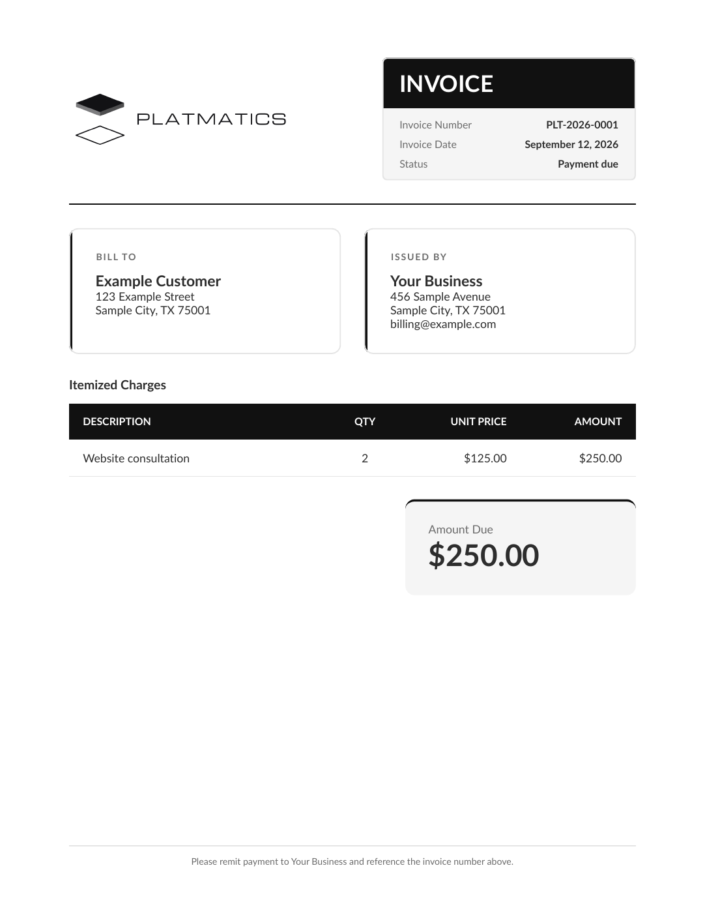
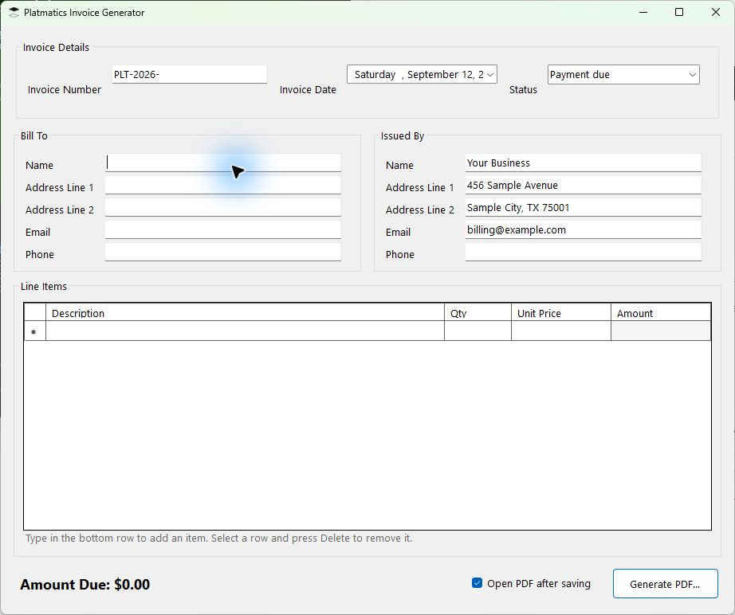

# Platmatics Invoice Generator

[](https://github.com/twbdavis/platmatics-invoice-generator/actions/workflows/ci.yml) [](LICENSE)

**Turn line items into a clean, printable PDF invoice.**

[Releases](https://github.com/twbdavis/platmatics-invoice-generator/releases) · [Example invoice](examples/sample-invoice.pdf) · [Report a bug](https://github.com/twbdavis/platmatics-invoice-generator/issues/new/choose)

[](examples/sample-invoice.pdf)

<details>
<summary>View the Windows application</summary>



</details>

A small Windows app for creating branded invoices. Enter your customer and issuer
details, add line items, review the total, and save a PDF where you choose.

- Editable invoice number, date, status, and billing details.
- Quantity and price validation with decimal-based totals.
- PDF export with optional automatic opening after saving.
- Local operation; no account or cloud service required.

## Get started

Requires Windows 10 or Windows 11. When available, download the Windows x64 ZIP
from [Releases](https://github.com/twbdavis/platmatics-invoice-generator/releases),
extract the entire folder, and run **PlatmaticsInvoice.exe**. Self-contained
packages include the .NET runtime. If no release is listed, build from source below.

1. Enter a complete invoice number and the **Bill To** and **Issued By** names.
2. Add a description, positive whole-number quantity, and non-negative unit price.
3. Review **Amount Due**, then choose **Generate PDF** and a destination.

Example: two consultation units at $125.00 produce a **$250.00** invoice.
See the [fictional example PDF](examples/sample-invoice.pdf).

## Build from source

Install the **.NET 8 SDK or later** on Windows:

```powershell
git clone https://github.com/twbdavis/platmatics-invoice-generator.git
cd platmatics-invoice-generator
dotnet run --project PlatmaticsInvoice
```

Run tests with `dotnet test tests/PlatmaticsInvoice.Tests -c Release`.
Run `scripts/package.ps1` for a self-contained Windows x64 ZIP and checksum.

## Customize

- **Issuer defaults:** edit PlatmaticsInvoice/sample-invoice.json before building,
  or sample-invoice.json beside the packaged executable. Only issuer details and
  status are loaded as defaults; the customer and line items start blank.
- **Logo:** replace Assets/platmatics-logo.png with your own image.
- **Invoice prefix:** edit the initial number in the app; change LoadDefaults in
  Forms/MainForm.cs to set a different default prefix.
- **Currency and layout:** the current app uses USD and US Letter. Currency
  formatting is defined in MainForm.cs and Documents/InvoiceDocument.cs; changing
  it requires updating both and rebuilding.

## Scope and status

A personal utility with a Platmatics template. Invoices are saved as PDFs;
there is no customer database, saved-draft workflow, automatic numbering, tax,
discount, or payment-processing system. Quantities are whole numbers. Review the
invoice before sending it. The bundled JSON and example PDF contain fictional data.

Built with C#, Windows Forms, .NET 8, and QuestPDF. QuestPDF has its own
[license terms](https://www.questpdf.com/license/overview.html); this project's
MIT license does not replace dependency licenses.

[Contributing](CONTRIBUTING.md) · [Security](SECURITY.md)

## License

[MIT](LICENSE) © 2026 Thomas Davis. Branding and third-party dependencies retain
their respective ownership and terms.
